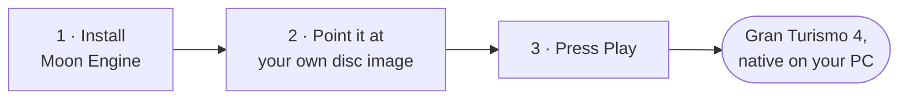
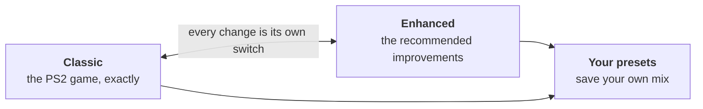
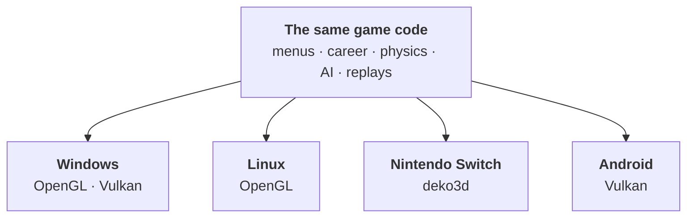
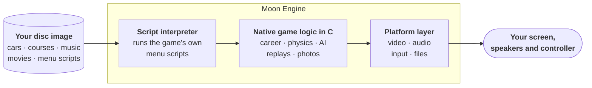
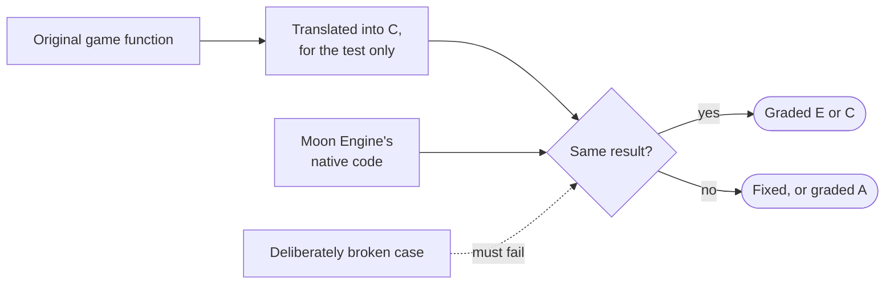
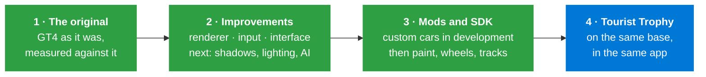

<div align="center">

# Moon Engine

### Gran Turismo 4, rebuilt to run natively — on PC, Nintendo Switch and Android.

The original game first, exactly as it was.<br/>
Then the version a studio would have kept alive.<br/>
**Bring your own disc.**

<br/>

[](#play-in-three-steps)
[](#mods-and-the-sdk)
[](#building-from-source)
[](#how-it-works)

<br/>


</div>

> [!IMPORTANT]
> **No game data is included.** This repository has no disc image, executables, BIOS, music, models, textures or save files. You need your own copy of the game and your own dump of the disc. Requests for game files will be closed.

> [!NOTE]
> Moon Engine is an unofficial fan project, not affiliated with or endorsed by Sony Interactive Entertainment or Polyphony Digital. Gran Turismo is a trademark of Sony Interactive Entertainment; all trademarks belong to their owners. The project is developed with heavy AI assistance.

<br/>

<table>
<tr>
<td width="33%" valign="top">

### Not an emulator

The game's own logic is rebuilt in C and runs directly on your machine. Only the PS2's arithmetic is reproduced, bit for bit, so the math comes out the same.

</td>
<td width="33%" valign="top">

### Faithful by proof

Every part of the game is compared with the original code and graded. Nothing is called faithful without a test.

</td>
<td width="33%" valign="top">

### Improved, never replaced

Every change from the PS2 is its own switch. One preset, **Classic**, puts the original back.

</td>
</tr>
</table>

---

## Contents

| | For players | | For modders and developers |
|---|---|---|---|
| 1 | [Play in three steps](#play-in-three-steps) | 7 | [How it works](#how-it-works) |
| 2 | [What you can play](#what-you-can-play) | 8 | [Deterministic PS2 math](#deterministic-ps2-math) |
| 3 | [What is better than the PS2](#what-is-better-than-the-ps2) | 9 | [How fidelity is measured](#how-fidelity-is-measured) |
| 4 | [Platforms](#platforms) | 10 | [Mods and the SDK](#mods-and-the-sdk) (WIP) |
| 5 | [Controls](#controls) | 11 | [Building from source](#building-from-source) |
| 6 | [FAQ](#faq) | 12 | [Documentation](#documentation) |
| | [Known issues](#known-issues) · [Roadmap](#roadmap) | | [Contributing](#contributing) · [Credits](#credits) · [License](#license) |

---

## Play in three steps



1. **Install.** Download `MoonEngine-<version>-setup.exe` and run it, or unzip `MoonEngine-<version>-win64.zip` anywhere.
2. **Choose your disc.** Start Moon Engine, pick **Game disc** and select your Gran Turismo 4 image (NTSC-U, SCUS-97328). It stays where it is; nothing is copied.
3. **Play.** Adjust Video, Audio and Controls if you like, then press **Play**.

To update, install the new version over the old one. Your saves and settings are kept.

<details>
<summary><b>Requirements</b></summary>

<br/>

| | Minimum |
|---|---|
| System | Windows 10 or 11, 64-bit; or Linux, built from source |
| Graphics | OpenGL 3.3 or Vulkan |
| Game | your own Gran Turismo 4 disc image, NTSC-U (SCUS-97328), version 1.01 or 2.00 |
| Input | a controller is recommended; keyboard and mouse work everywhere |

To check a v2.00 dump, `CORE.GT4` on the disc has the SHA-1 `30031137ce494323816bb707b90d3ec0d07937d2`.

</details>

<details>
<summary><b>Where your data lives</b></summary>

<br/>

| What | Windows |
|---|---|
| Profiles, saves, replays, photos | `%APPDATA%\MoonEngine\MoonEngine\` |
| Settings | `%APPDATA%\MoonEngine\MoonEngine\options.ini` |
| Mods | `%APPDATA%\MoonEngine\MoonEngine\mods\` |

`--save-dir <folder>` keeps everything elsewhere. Moon Engine was previously named OpenGT4; on first start, data from the old OpenGT4 folder is copied over.

</details>

<details>
<summary><b>Bringing your PS2 data</b></summary>

<br/>

- **GT4 PS2 saves, photos and replays** can be imported from your own memory card dumps.
- **The US GT3 transfer** (credits and B/A licences) works as it did on the PS2.

Where to place the files: [docs/SAVEGAMES.md](docs/SAVEGAMES.md).

</details>

---

## What you can play

Every mode on the disc, listed from the game's own menus so nothing is forgotten.

 works end to end &nbsp;
 not available yet &nbsp;
 on the roadmap

<table>
<tr>
<td width="50%" valign="top">

#### Racing

| | |
|---|---|
| Arcade single race, garage cars, dirt and snow |  |
| Time Trial, ghosts, records, ranking codes |  |
| Two-player split screen, with 2P replays |  |
| Free Run and Practice |  |
| Power & Speed test course |  |
| LAN play |  |

#### Driving school and challenges

| | |
|---|---|
| Licences: all 80 tests, demos, ghosts |  |
| Driving missions: all 34 |  |
| B-Spec: be the team director |  |

</td>
<td width="50%" valign="top">

#### GT Mode

| | |
|---|---|
| Home, garage, calendar, progress |  |
| New and used dealers, black cars |  |
| Tune Shop, GT Auto, car settings |  |
| Events: 144 series, 527 races |  |
| Championships and prize cars |  |
| Endurance: all 16 events |  |

#### Replays, photos and extras

| | |
|---|---|
| Replays and Replay Theater |  |
| Photo Travel (15 locations), Photo Drive |  |
| Photo album, slideshow, Photo Lab |  |
| Logger telemetry, Jukebox, secrets |  |
| Tourist Trophy |  |

</td>
</tr>
</table>

The event, endurance and licence figures are what the test runs actually drove to the finish, without injected results. Not planned for now: online services, EyeToy and photo printing.

---

## What is better than the PS2

> **In short:** sharper, smoother and easier to control, with the original always one click away.



Physics and race rules are **never** a setting. Lap times, ghosts, replays and saves stay valid whatever you choose.

<table>
<tr>
<td width="50%" valign="top">

#### Image

- Any resolution, up to ultrawide; the game's own 16:9 mode
- **Unlimited frame rate**, or a cap at 60, 90, 120, 144, 165 or 240 FPS
- OpenGL, or the experimental Vulkan renderer
- Supersampling, MSAA, render scale, AMD FSR 1
- Smooth textures where the PS2 drew them blocky
- HD menu images, upscaled locally from your own disc
- The PS2 look on request: 640x448, dithering, interlacing

</td>
<td width="50%" valign="top">

#### Play

- **Mouse and keyboard** in every menu: hover, click, scroll, drag
- Button hints that follow your device: keyboard, Xbox or PlayStation
- Any controller, remappable, with the game's own vibration
- Two players on one PC
- **Cinematic camera** (F9) and inspection camera (F3) in races and replays
- Photos saved as PNG at your screen's resolution
- A launcher with a live preview of your own car

</td>
</tr>
</table>

Every option, its Classic value and its Enhanced value: [docs/OPTIONS.md](docs/OPTIONS.md).

---

## Platforms

One code base, four platforms. The game never talks to the hardware directly, so each platform only supplies its own window, sound, input and files. **Physics, AI and career are identical everywhere.**



<table>
<tr>
<th width="25%">Windows and Linux</th>
<th width="25%">Nintendo Switch</th>
<th width="25%">Android</th>
<th width="25%">Coming next</th>
</tr>
<tr>
<td valign="top">


- Unlimited frame rate or 60–240 FPS cap
- VSync, low-latency Vulkan queue
- Vulkan pipeline cache against stutter
- Ultrawide, supersampling, FSR
- Mouse, keyboard, launcher
- Mods page and SDK (in development)

</td>
<td valign="top">


- Its own **deko3d** renderer
- Scene resolution: Classic 640x448, Balanced 960x540 handheld / 1280x720 docked, Performance
- Touch menus in handheld
- Saves on the SD card
- Windows setup tool: USB (DBI) or network (Nxlink)

</td>
<td valign="top">


- Vulkan renderer shared with the PC
- Opens your disc through the system file picker, no broad permissions
- Touch menus
- Optional **touch race controls**: three sizes, opacity, mirrored layout
- Controllers take over automatically

</td>
<td valign="top">


- Switch: frame rate and full visual check on hardware
- Android: movies, save import and export, phone validation
- Linux: Vulkan testing

</td>
</tr>
</table>

Details: [docs/SWITCH.md](docs/SWITCH.md) · [docs/ANDROID.md](docs/ANDROID.md) · [docs/VULKAN.md](docs/VULKAN.md)

---

## Controls

Any controller SDL2 recognises works, with the PlayStation layout. Everything can be remapped in the launcher or the game's Options.

| Action | Controller | Keyboard |
|---|:---:|:---:|
| Steer | left stick | ← → |
| Accelerate / brake | ✕ / □ | ↑ / ↓ |
| Shift up / down | R2 / L2 | A / Z |
| Handbrake | ○ | Space |
| Reverse | △ | |
| Look back / change view | L1 / Select | V |
| Pause | Start | Esc |

<details>
<summary><b>Menus, cameras and the command line</b></summary>

<br/>

**Menus:** left stick or D-pad with ✕ and ○; or the mouse; or the arrow keys, Enter and Esc. L1 and R1 (Q and E) switch tabs. F10 quits.

**PC cameras:**

| Key | Action |
|---|---|
| F9 | cinematic camera: WASD to move, Q/E down and up, mouse to look, wheel to zoom, F follow or free |
| F3 | inspection camera |

**Command line:** `MoonEngine <your disc image> [options]`

| Option | Effect |
|---|---|
| `--fullscreen` / `--window` | full screen or a window |
| `--renderer opengl` / `vulkan` | graphics backend |
| `--save-dir <folder>` | keep profiles, settings and replays elsewhere |
| `--skip-intro` | skip the opening movie |
| `--split-screen` | start a two-player race |
| `--preview <car>` | open a car in the showroom |

</details>

---

## How it works

> **In short:** your disc holds the game's content and its menu scripts. Moon Engine reads them and runs the game with its own native code, instead of pretending to be a PlayStation 2.



Everything that once spoke to PlayStation 2 hardware is replaced at the library boundary:

| On the PlayStation 2 | | In Moon Engine |
|---|:---:|---|
| Graphics Synthesizer and VU1 microcode | → | OpenGL, Vulkan or deko3d renderer |
| VU0 vector code | → | plain C |
| EE floating-point unit, with its own rounding | → | reproduced bit for bit in software |
| SPU2 sound processor | → | PC audio mixing through SDL2 |
| IOP, CD/DVD streaming | → | direct reads from your disc image |
| Memory cards | → | save files |
| Kernel threads | → | operating system threads |
| Controller port | → | SDL2 controllers, keyboard, mouse, touch |

The menus are the **game's own Adhoc scripts**, so every screen behaves as the original decided. Nothing is extracted, converted or installed: all content is read from your disc at run time. More: [docs/HOW_IT_WORKS.md](docs/HOW_IT_WORKS.md) · [docs/ARCHITECTURE.md](docs/ARCHITECTURE.md)

### Deterministic PS2 math

> **In short:** the PS2 does its decimal math slightly differently from a PC. Moon Engine reproduces that difference exactly, or the game's own recordings would drive off the road.

The PS2's main processor does not round floating-point numbers the way a PC does: additions, multiplications, divisions and square roots can differ in their last bits, and even the order of the operands matters. One wrong bit is invisible on its own, but a race simulates thousands of steps, and the error grows.

The game's demos, licence demonstrations and replays store only the **driver's inputs**, not the car's position. Played back with PC math, the same inputs slowly lead the car somewhere else: the original demos go wide, miss corners and end in the wrong place, and lap times stop matching the PS2.


So the physics runs on the **PS2's own arithmetic**, reproduced in software from a hardware-derived model (`third_party/ps2float`, from PCSX2). At build time, every floating-point operation in the simulation is routed through it, keeping the original operand order. The result is deterministic: the same inputs give the same race, whatever the PC's own floating-point hardware would have rounded. This is part of the original behaviour, not an option, and it applies to every mode. Details: [docs/notes/DISC_REPLAY_ARITHMETIC.md](docs/notes/DISC_REPLAY_ARITHMETIC.md).

---

## How fidelity is measured

> **In short:** "it looks right" is not enough. Each part of the game is compared with the original and given a grade, and the proof is written down.


| Grade | Meaning |
|:---:|---|
| **E** | identical to the original, value by value or bit by bit, proved by an automated comparison |
| **C** | the original's data and formulas; output matches within a stated tolerance |
| **V** | built from the original's code and data, compared side by side with the PS2 game |
| **A** | close, with a known and recorded difference |
| **F** | the original has it; the port does not yet |
| **P** | different on purpose: resolution, loading, PC files |
| **N** | out of scope or impossible |



Many tests run the **original game's own code as an oracle**: one original function is translated into C inside the test, run on the same input as Moon Engine's native code, and compared. Each comparison has a deliberately broken twin that must fail, so a test that passes everything is caught. The translated code never ships in the game. Fidelity is always measured with **Classic** and no mods. The full record: [docs/FIDELITY.md](docs/FIDELITY.md).

---

## Mods and the SDK

> [!NOTE]
> **Work in progress — not released yet.** Mod support and the Moon Engine SDK are in active development and are not part of any release. Everything below describes the plan and what already works in development builds; the package format and tools will change.

> **In short:** the plan is simple: drop a mod in a folder, switch it on, and new cars appear in the game. Your disc is never touched.


### Using mods (planned workflow)

Place a mod folder, or a `.zip` from the SDK, in your mod folder and switch it on in the launcher's **Mods** page. The change counts from the next start.

| System | Mod folder |
|---|---|
| Windows | `%APPDATA%\MoonEngine\MoonEngine\mods\` |
| Linux | `~/.local/share/MoonEngine/MoonEngine/mods/` |

Mods add files beside the original content by their path on the disc. With no mod on, the game is exactly your disc.

### Custom cars

<table>
<tr>
<td width="50%" valign="top">

#### Working in development builds

- Its own name, maker badge, country flag, price
- Its own power, torque, weight, drivetrain, gearing
- Wheelbase, track and ride height
- The engine sound of any car on the disc
- Textures at full authored size on PC
- Dark see-through glass and the paint's reflection layer
- Wheels placed where the model has them
- Race cameras from the source car or authored in the SDK
- Dealer pictures rendered in the disc's own pose

</td>
<td width="50%" valign="top">

#### Planned

- Release of the SDK and the mod tools
- Paint colours for custom cars
- Custom wheels and tyres
- Custom tracks
- A stable package format

</td>
</tr>
</table>

The **Moon Engine SDK**, also in development, is a companion desktop app that wraps these tools: import a model, assign wheels and cameras, set the specifications, build, verify the package against the disc and preview it in the engine's own showroom. Step by step: [docs/vulcan4/SDK-MAKING-A-CAR.md](docs/vulcan4/SDK-MAKING-A-CAR.md) · format: [docs/MODS.md](docs/MODS.md)

---

## Building from source

SDL2 and miniz are fetched by CMake, so the first configure needs network access. FFmpeg is used at run time for the game's movies.

<table>
<tr>
<th width="50%">Windows</th>
<th width="50%">Linux</th>
</tr>
<tr>
<td valign="top">

Visual Studio 2022 (or Build Tools), CMake 3.20+

```
cmake -S . -B build -G "Visual Studio 17 2022"
cmake --build build --config Release --target moonengine
```

</td>
<td valign="top">

GCC or Clang, CMake 3.20+, OpenGL dev libraries, `ffmpeg`

```bash
cmake -S . -B build -DCMAKE_BUILD_TYPE=Release
cmake --build build -j
```

</td>
</tr>
</table>

<details>
<summary><b>Tests</b></summary>

<br/>

```
ctest --test-dir build -C Release
```

| Configure option | Adds |
|---|---|
| (default) | unit tests on synthetic data, no disc needed |
| `-DMOON_TEST_DISC=<your disc image>` | tests that read your disc |
| `-DMOON_RECOMP_TESTS=ON` | original-code oracle comparisons (needs a local analysis setup) |

Every comparison is paired with a deliberate negative case that must fail. Details: [docs/BUILDING_AND_TESTING.md](docs/BUILDING_AND_TESTING.md).

</details>

<details>
<summary><b>Packaging</b></summary>

<br/>

`tools/package_release.py` builds the Windows installer and portable zip. Switch and Android: [docs/SWITCH.md](docs/SWITCH.md), [docs/ANDROID.md](docs/ANDROID.md).

</details>

<details>
<summary><b>Repository layout</b></summary>

<br/>

```
include/platform/    platform interfaces: video, audio, input, files, time
src/core/            game code with no hardware: disc formats, UI, menus, career, saves, replays
src/core/adhoc/      the interpreter for the game's own menu scripts
src/core/physics/    car physics, rival AI, the race session
src/platform/        SDL2, OpenGL, Vulkan and Switch backends
src/app/             the program, its launcher, race, photo and settings screens
tests/               unit tests, disc tests and original-code oracles
tools/c/             mod tools (moonmod_*) and disc readers (gt4*)
tools/               packaging and analysis tools
third_party/         bundled third-party code, each with its licence
docs/                formats, design notes, status, the fidelity record
```

Porting to another system means implementing `include/platform/`.

</details>

---

## Documentation

| Start here | Go deeper | File formats |
|---|---|---|
| [How it works](docs/HOW_IT_WORKS.md) | [Fidelity record](docs/FIDELITY.md) | [VOL](docs/VOL_FORMAT.md) |
| [Architecture](docs/ARCHITECTURE.md) | [Options](docs/OPTIONS.md) | [Tex1](docs/TEX1_FORMAT.md) |
| [Roadmap](docs/ROADMAP.md) | [Renderer](docs/RENDERER.md) · [Vulkan](docs/VULKAN.md) | [Models](docs/MODELS.md) |
| [Editions](docs/EDITIONS.md) | [Input](docs/INPUT.md) | [Courses](docs/COURSES.md) |
| [Mods](docs/MODS.md) | [Launcher](docs/LAUNCHER.md) | [UI](docs/UI_FORMAT.md) |
| [Making a car](docs/vulcan4/SDK-MAKING-A-CAR.md) | [Save games](docs/SAVEGAMES.md) | [Text](docs/TEXT_FORMAT.md) |
| [Docs index](docs/README.md) | [UI art direction](docs/UI_ART_DIRECTION.md) | [Adhoc scripts](docs/ADHOC.md) |

---

## Roadmap



Green is in progress, blue comes later. These are development stages, not promises: [docs/ROADMAP.md](docs/ROADMAP.md).

---

## Known issues

Moon Engine is in **alpha**. Before reporting a problem, check this list and the open [Issues](../../issues).

- LAN play is not available.
- Some sounds and visual details still differ from the PS2: a few night-lamp and start-gantry shadows, the backfire glow, parts of Photo Travel's collision.
- Original PS2 recordings still need wider validation on real memory cards and other regions ([details](docs/notes/DISC_REPLAY_ARITHMETIC.md)).
- The Vulkan renderer, the Switch build and the Android build are experimental.
- Mods and the SDK are a work in progress and not released yet.

When reporting a bug, say what you were doing and which disc version you have, and attach a screenshot if you can.

---

## FAQ

<details>
<summary><b>Is this an emulator?</b></summary>
<br/>No. The PS2 processor is never emulated and the console's operating system never runs; the game's logic is rebuilt in C. The one thing reproduced exactly is the PS2's floating-point arithmetic, because the game's own demos, replays and lap times depend on it (see <a href="#deterministic-ps2-math">Deterministic PS2 math</a>).
</details>

<details>
<summary><b>Do I need a PS2 BIOS?</b></summary>
<br/>No. Only your own disc image.
</details>

<details>
<summary><b>Which discs work?</b></summary>
<br/>The NTSC-U release, SCUS-97328, versions 1.01 and 2.00. Other regions and Gran Turismo 4 Spec II are not supported yet.
</details>

<details>
<summary><b>Will my lap times and replays match the PS2?</b></summary>
<br/>That is the goal. Physics and race rules are never changed by any option, the physics runs on the PS2's own arithmetic, and replays record only what the original records: the inputs.
</details>

<details>
<summary><b>Can I play exactly the original game?</b></summary>
<br/>Yes. Choose the <b>Classic</b> preset and turn every mod off.
</details>

<details>
<summary><b>Does a higher frame rate change the physics?</b></summary>
<br/>No. The frame limit only changes how often the picture is drawn; the simulation keeps the game's original fixed rate and the PS2's arithmetic.
</details>

<details>
<summary><b>Where can I get the game?</b></summary>
<br/>From your own copy. This project does not provide or link to game files.
</details>

---

## Contributing

Pull requests are not being accepted at the moment. Bug reports and suggestions are welcome in [Issues](../../issues). Never post game assets, disc dumps or copyrighted binaries.

## Credits

- The Gran Turismo modding community, whose research made the game's file formats and scripts understandable; in particular Nenkai's [PDTools](https://github.com/Nenkai/PDTools) (MIT), against which the model and course formats were cross-checked.
- [SDL2](https://www.libsdl.org/) (zlib) and [miniz](https://github.com/richgel999/miniz) (MIT), fetched by CMake.
- AMD FidelityFX Super Resolution 1 headers in `third_party/fsr1` (MIT).
- [stb_image](https://github.com/nothings/stb) in `third_party/stb` (MIT).
- `third_party/ps2float` from PCSX2 (LGPL-3.0-or-later), PS2 floating-point arithmetic, with its licence files.
- [FFmpeg](https://ffmpeg.org/) for movie playback, shipped with its own licence text.
- The launcher's icons are from the Tango Icon Library (public domain).

## License

Moon Engine is free software under the **GNU General Public License, version 3** ([LICENSE](LICENSE)), with additional terms under its section 7 ([NOTICE](NOTICE)):

- **Attribution:** any work that contains or is derived from Moon Engine must say "Based on Moon Engine" in its documentation and, if it has a user interface, somewhere users can see it (an About, credits or launcher screen).
- **Modified versions** must be marked as different from the original and must not be presented as the official Moon Engine.

Anyone who distributes Moon Engine or a work based on it must also make its source code available under the same terms. The license covers the code in this repository only, not the game.

<div align="center">
<br/>
<sub>Moon Engine · an unofficial fan project · bring your own disc</sub>
</div>
