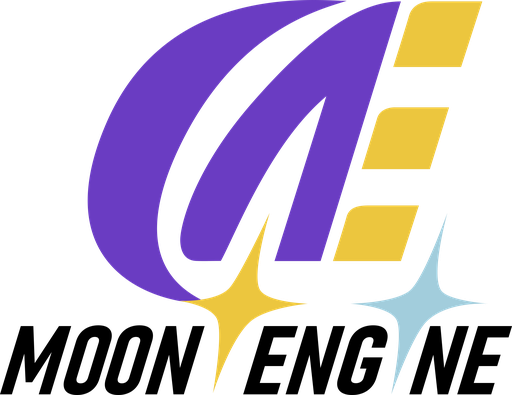
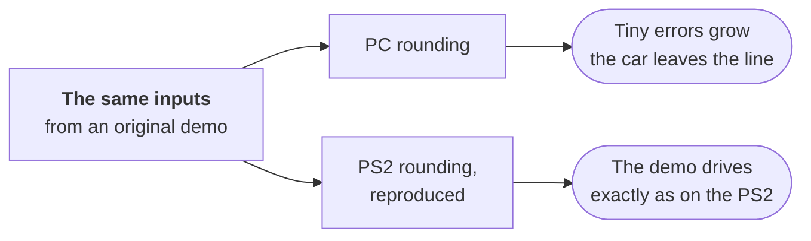
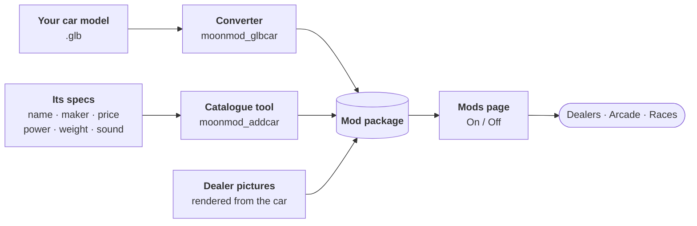
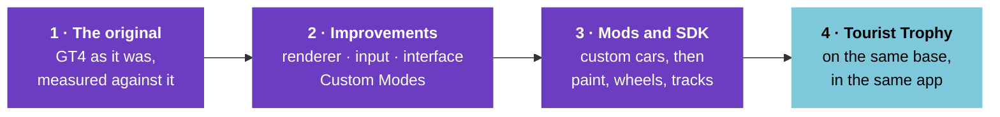

<div align="center">

<br/>

<picture>
  <source media="(prefers-color-scheme: dark)" srcset="res/logo_white.png">
  
</picture>

<br/>
<br/>

## Gran Turismo 4, running natively on your PC.

**No emulator. No BIOS. No setup headaches.**<br/>
Point it at your own disc and drive — sharper, smoother and still exactly the game you remember.

<br/>

[](../../releases/latest)
&nbsp;
[](../../releases/latest)
&nbsp;
[](../../releases/latest)
<br/><br/>
[](#-start-playing-in-3-steps)
&nbsp;
[](#-questions)

<br/>


</div>

<br/>

> [!IMPORTANT]
> **You bring the game.** Moon Engine contains no game data: no disc image, music, cars, tracks, BIOS or saves. You need your own copy of Gran Turismo 4 (USA, SCUS-97328) and your own dump of it. Requests for game files will be closed.

<br/>

<table>
<tr>
<td width="33%" align="center" valign="top">
<br/>

<h3>Not an emulator</h3>
The game's own logic, rebuilt in C, running straight on your machine. Fast to start, light on your PC.
<br/><br/>
</td>
<td width="33%" align="center" valign="top">
<br/>

<h3>The real GT4</h3>
Same physics, same lap times, same career. Every part is checked against the original before it is called done.
<br/><br/>
</td>
<td width="33%" align="center" valign="top">
<br/>

<h3>Made for today</h3>
Any resolution, high frame rates, mouse and keyboard, any controller. One click brings the PS2 look back.
<br/><br/>
</td>
</tr>
</table>

---

## ▸ Start playing in 3 steps

<table>
<tr>
<td width="33%" valign="top">

### 1 · Download

Get your file from the [latest release](../../releases/latest):

- **Windows:** `MoonEngine-<version>-win64.zip`
- **Linux:** `MoonEngine-<version>-linux-x86_64.tar.gz`
- **Switch:** `MoonEngine-<version>-switch.zip`

Unzip it anywhere you like.

</td>
<td width="33%" valign="top">

### 2 · Choose your disc

Open **MoonEngine.exe** (Linux: `./MoonEngine`) and select your Gran Turismo 4 disc image (`.iso`). It stays where it is — nothing is copied or changed.

On Switch, see [Switch setup](#switch-setup) below.

</td>
<td width="33%" valign="top">

### 3 · Drive

Set video, sound and controls if you want, then press **Start**. Your saves, replays and photos are kept for you.

</td>
</tr>
</table>

**On Windows, updates take care of themselves.** When a new version comes out, Moon Engine downloads it in the background and installs it when you quit. Your saves and settings are never touched. (Don't want that? Set `updates.auto=0` in `options.ini`.) On Linux and Switch, download the new release and replace the program.

<details id="switch-setup">
<summary><b>Switch setup</b></summary>

<br/>

You need a Switch that runs homebrew, an SD card formatted as **exFAT** (the disc image is bigger than 4 GB) and your own GT4 disc image.

1. Copy the `switch` folder from the zip to the root of the SD card. The program ends up at `switch/moonengine/moonengine.nro`.
2. Copy your disc image to `switch/moonengine/gt4.iso`.
3. Open the Homebrew Menu **by holding R while launching a game** (full memory; the album applet does not have enough) and start Moon Engine.

Saves stay in `switch/moonengine/`. Details and troubleshooting: [docs/SWITCH.md](docs/SWITCH.md).

</details>

<details>
<summary><b>What do I need?</b></summary>

<br/>

| | |
|---|---|
| **Computer** | Windows 10 or 11, 64-bit; Linux x86-64 with OpenGL; or a Switch that runs homebrew |
| **Graphics** | any card with OpenGL 3.3 or Vulkan |
| **Game** | your own Gran Turismo 4 disc image, USA version (SCUS-97328), 1.01 or 2.00 |
| **Controller** | recommended, any model; keyboard and mouse work everywhere too |

</details>

<details>
<summary><b>Where are my saves?</b></summary>

<br/>

Everything lives in `%APPDATA%\MoonEngine\MoonEngine\`: profiles, saves, replays, photos, settings and mods. Start with `--save-dir <folder>` to keep it somewhere else.

Already have GT4 saves, photos or replays from a PS2 memory card? You can bring them in — see [docs/SAVEGAMES.md](docs/SAVEGAMES.md). The GT3 licence and credits transfer works too.

</details>

---

## ▸ What you can play

Every mode on the disc. Not "mostly works" — driven to the finish line in testing.

<table>
<tr>
<td width="50%" valign="top">

#### Racing
- Arcade races on every track, dirt and snow included
- Time Trial with ghosts and records
- **Two players** on one screen, with replays
- Free Run, Practice, Power & Speed test

#### Driving school
- All **80 licence tests**, with demos and ghosts
- All **34 missions**
- B-Spec: run the race as team director

</td>
<td width="50%" valign="top">

#### GT Mode
- Home, garage, dealers (new, used, black cars)
- Tune Shop and GT Auto
- **144 series, 527 races**, championships and prize cars
- All **16 endurance** events

#### Extras
- Replay Theater and Photo Travel (15 locations)
- Photo Drive, album and slideshow
- Jukebox, Logger telemetry, secrets

</td>
</tr>
</table>

<sub>Not in yet: LAN play. Not planned: online services, EyeToy, photo printing.</sub>

---

## ▸ Classic or Enhanced? You choose.

Every change from the PS2 is its own switch. Pick a preset, or mix your own.

<table>
<tr>
<th width="50%">Classic</th>
<th width="50%">Enhanced</th>
</tr>
<tr>
<td valign="top">

The PlayStation 2 game, exactly as it was.

- 640×448 image, the original look
- Original menus and button symbols

</td>
<td valign="top">

The version a studio would have kept alive.

- Any resolution, ultrawide, 16:9
- **Unlimited frame rate**, or a cap from 60 to 240 FPS
- Supersampling, MSAA, AMD FSR 1, OpenGL or Vulkan
- Mouse and keyboard in every menu
- Button hints for keyboard, Xbox or PlayStation pads
- Cinematic camera (F9) and inspection camera (F3)
- Photos saved as PNG at full screen resolution

</td>
</tr>
</table>

> **Physics and race rules are never a setting.** Lap times, ghosts, replays and saves stay valid whatever you choose. Every option is listed in [docs/OPTIONS.md](docs/OPTIONS.md).

---

## ▸ Coming soon

<table>
<tr>
<td width="33%" valign="top">

#### Custom Modes
New ways to race inside GT Mode, starting with **Elimination**: the last car at each lap line is out.

</td>
<td width="33%" valign="top">

#### Mods and the SDK
Drop a car in a folder, switch it on, and find it at the dealer. Custom tracks after that. [Read more](#mods-and-the-sdk)

</td>
<td width="33%" valign="top">

#### Tourist Trophy
The motorcycle game, on the same engine, in the same app.

</td>
</tr>
</table>

---

## ▸ Platforms

One engine, four systems. The game never talks to the hardware directly, so physics, AI and career are **identical everywhere**.

| | Status | Highlights |
|---|---|---|
| **Windows** |  | OpenGL and Vulkan, unlimited FPS, mouse and keyboard, automatic updates |
| **Linux** |  | OpenGL, the same game as on Windows |
| **Nintendo Switch** |  | homebrew, its own deko3d renderer, touch menus in handheld, saves on SD |
| **Android** |  | Vulkan, touch menus, optional on-screen race controls |

More: [Switch](docs/SWITCH.md) · [Android](docs/ANDROID.md) · [Vulkan](docs/VULKAN.md)

---

## ▸ Controls

Any controller works with the PlayStation layout, and everything can be remapped.

| | Controller | Keyboard |
|---|:---:|:---:|
| Steer | left stick | ← → |
| Accelerate / brake | ✕ / □ | ↑ / ↓ |
| Shift up / down | R2 / L2 | A / Z |
| Handbrake | ○ | Space |
| Reverse | △ | R |
| Look back / change view | L1 / Select | V |
| Pause | Start | Esc |
| Menus | stick, ✕, ○ | mouse, arrows, Enter, Esc · Q/E switch tabs |

<details>
<summary><b>Cameras and command line</b></summary>

<br/>

| Key | |
|---|---|
| **F9** | cinematic camera — WASD to move, Q/E down and up, mouse to look, wheel to zoom, F to follow |
| **F3** | inspection camera |
| **F10** | quit |

`MoonEngine <disc image> [--fullscreen | --window] [--renderer opengl|vulkan] [--save-dir <folder>] [--skip-intro] [--split-screen]`

</details>

---

## ▸ Questions

<details>
<summary><b>Is this an emulator?</b></summary>
<br/>No. The PlayStation 2 is never emulated. The game's logic is rewritten in C and runs natively. The one thing copied exactly is how the PS2 does its decimal math, because GT4's demos, replays and lap times depend on it.
</details>

<details>
<summary><b>Do I need a PS2 BIOS?</b></summary>
<br/>No. Just your own disc image.
</details>

<details>
<summary><b>Which version of the game works?</b></summary>
<br/>The USA release (SCUS-97328), versions 1.01 and 2.00. Other regions and GT4 Spec II are not supported yet.
</details>

<details>
<summary><b>Will my lap times match the PS2?</b></summary>
<br/>That is the whole point. The physics runs on the PS2's own arithmetic, no option changes it, and a higher frame rate only changes how often the picture is drawn.
</details>

<details>
<summary><b>Can I play the original, untouched?</b></summary>
<br/>Yes. Choose the <b>Classic</b> preset and leave mods off.
</details>

<details>
<summary><b>Where do I get the game?</b></summary>
<br/>From your own copy. This project does not provide or link to game files.
</details>

<details>
<summary><b>Something is broken. What now?</b></summary>
<br/>Moon Engine is in alpha. Check the <a href="#known-issues">known issues</a> and the open <a href="../../issues">Issues</a>, then open a new one: say what you were doing and your disc version, and add a screenshot if you can.
</details>

---

<div align="center">

### For modders and developers

The rest of this page is the technical side: how it works, how fidelity is proven, mods, and building from source.

</div>

---

## How it works

> **In short:** your disc holds the game's content and its menu scripts. Moon Engine reads them and runs the game with its own native code, instead of pretending to be a PlayStation 2.


Everything that once spoke to PlayStation 2 hardware is replaced at the library boundary:

| On the PlayStation 2 | | In Moon Engine |
|---|:---:|---|
| Graphics Synthesizer and VU1 microcode | → | OpenGL, Vulkan or deko3d renderer |
| VU0 vector code | → | plain C |
| EE floating-point unit, with its own rounding | → | reproduced bit for bit in software |
| SPU2 sound processor | → | PC audio mixing through SDL2 |
| IOP, CD/DVD streaming | → | direct reads from your disc image |
| Memory cards | → | save files |
| Kernel threads | → | operating system threads |
| Controller port | → | SDL2 controllers, keyboard, mouse, touch |

The menus are the **game's own Adhoc scripts**, so every screen behaves as the original decided. Nothing is extracted, converted or installed: all content is read from your disc at run time. More: [docs/HOW_IT_WORKS.md](docs/HOW_IT_WORKS.md) · [docs/ARCHITECTURE.md](docs/ARCHITECTURE.md)

<details>
<summary><b>Deterministic PS2 math</b></summary>

<br/>

The PS2's main processor does not round floating-point numbers the way a PC does: results can differ in their last bits, and even the order of the operands matters. One wrong bit is invisible on its own, but a race simulates thousands of steps, and the error grows.

The game's demos, licence demonstrations and replays store only the **driver's inputs**. Played back with PC math, the same inputs slowly lead the car somewhere else: the original demos go wide, miss corners and end in the wrong place.



So the physics runs on the **PS2's own arithmetic**, reproduced in software (`third_party/ps2float`, from PCSX2), with the original operand order. The same inputs give the same race on every PC. Details: [docs/notes/DISC_REPLAY_ARITHMETIC.md](docs/notes/DISC_REPLAY_ARITHMETIC.md).

</details>

## How fidelity is measured

> **In short:** "it looks right" is not enough. Each part of the game is compared with the original and given a grade, and the proof is written down.

| Grade | Meaning |
|:---:|---|
|  | identical to the original, value by value or bit by bit, proved by an automated comparison |
|  | the original's data and formulas; output matches within a stated tolerance |
|  | built from the original's code and data, compared side by side with the PS2 game |
|  | close, with a known and recorded difference |
|  | the original has it; the port does not yet |
|  | different on purpose: resolution, loading, PC files |
|  | out of scope or impossible |

Many tests run the **original game's own code as an oracle**: one original function is translated into C inside the test, run on the same input as Moon Engine's native code, and compared. Each comparison has a deliberately broken twin that must fail, so a test that passes everything is caught. The translated code never ships. Fidelity is always measured with **Classic** and no mods. The full record: [docs/FIDELITY.md](docs/FIDELITY.md).

## Mods and the SDK

> [!NOTE]
> **Work in progress — not part of any release yet.** The package format and tools will change.

The plan is simple: drop a mod in a folder, switch it on, and new cars appear in the game. Your disc is never touched.



<table>
<tr>
<td width="50%" valign="top">

#### Working in development builds
- Its own name, maker badge, country flag, price
- Its own power, torque, weight, drivetrain, gearing
- Wheelbase, track and ride height
- The engine sound of any car on the disc
- Full-size textures, see-through glass, paint reflections
- Race cameras and dealer pictures

</td>
<td width="50%" valign="top">

#### Planned
- Release of the SDK and the mod tools
- Paint colours, custom wheels and tyres
- Custom tracks
- A stable package format

</td>
</tr>
</table>

Mods go in `%APPDATA%\MoonEngine\MoonEngine\mods\` (Linux: `~/.local/share/MoonEngine/MoonEngine/mods/`). Step by step: [docs/vulcan4/SDK-MAKING-A-CAR.md](docs/vulcan4/SDK-MAKING-A-CAR.md) · format: [docs/MODS.md](docs/MODS.md)

## Building from source

SDL2 and miniz are fetched by CMake, so the first configure needs network access.

<table>
<tr>
<th width="50%">Windows</th>
<th width="50%">Linux</th>
</tr>
<tr>
<td valign="top">

Visual Studio 2022 (or Build Tools), CMake 3.20+

```
cmake -S . -B build -G "Visual Studio 17 2022"
cmake --build build --config Release --target moonengine
```

</td>
<td valign="top">

GCC or Clang, CMake 3.20+, OpenGL dev libraries, `ffmpeg`

```bash
cmake -S . -B build -DCMAKE_BUILD_TYPE=Release
cmake --build build -j
```

</td>
</tr>
</table>

<details>
<summary><b>Dev and stable builds</b></summary>

<br/>

A normal build is a **dev build** (`MOON_DEV_BUILD=ON`, shown as "dev" next to the version): it keeps the developer shortcuts (PgUp/PgDn and F1/F2 to jump between screens, F4 debug overlay) and never looks for updates.

Releases are **stable builds**: configure with `-DMOON_DEV_BUILD=OFF`. They have no developer shortcuts and update themselves from this repository's GitHub releases. `tools/package_release.py` builds the `MoonEngine-<version>-win64.zip` that the updater looks for; upload it to the release under that exact name.

</details>

<details>
<summary><b>Tests</b></summary>

<br/>

```
ctest --test-dir build -C Release -R <area>
```

| Configure option | Adds |
|---|---|
| (default) | unit tests on synthetic data, no disc needed |
| `-DMOON_TEST_DISC=<your disc image>` | tests that read your disc |
| `-DMOON_RECOMP_TESTS=ON` | original-code oracle comparisons (needs a local analysis setup) |

Every comparison is paired with a deliberate negative case that must fail. Details: [docs/BUILDING_AND_TESTING.md](docs/BUILDING_AND_TESTING.md).

</details>

<details>
<summary><b>Repository layout</b></summary>

<br/>

```
include/platform/    platform interfaces: video, audio, input, files, time
src/core/            game code with no hardware: disc formats, UI, menus, career, saves, replays
src/core/adhoc/      the interpreter for the game's own menu scripts
src/core/physics/    car physics, rival AI, the race session
src/platform/        SDL2, OpenGL, Vulkan and Switch backends
src/app/             the program, its launcher, race, photo and settings screens
tests/               unit tests, disc tests and original-code oracles
tools/               mod tools, packaging and analysis tools
third_party/         bundled third-party code, each with its licence
docs/                formats, design notes, status, the fidelity record
```

Porting to another system means implementing `include/platform/`. All the docs: [docs/README.md](docs/README.md).

</details>

## Roadmap



Purple is in progress, blue comes later. Stages, not promises: [docs/ROADMAP.md](docs/ROADMAP.md).

## Known issues

- LAN play is not available.
- Some sounds and visual details still differ from the PS2: a few night-lamp and start-gantry shadows, the backfire glow, parts of Photo Travel's collision.
- Original PS2 recordings still need wider validation on real memory cards and other regions.
- Vulkan and Android are experimental; the Switch build is new and still gets fixes.
- Mods, the SDK and Custom Modes are not released yet.

## Contributing

Pull requests are not being accepted at the moment. Bug reports and suggestions are welcome in [Issues](../../issues). Never post game assets, disc dumps or copyrighted binaries.

## Credits

- The Gran Turismo modding community, whose research made the game's formats understandable; in particular Nenkai's [PDTools](https://github.com/Nenkai/PDTools) (MIT).
- [SDL2](https://www.libsdl.org/) (zlib), [miniz](https://github.com/richgel999/miniz) (MIT), [stb](https://github.com/nothings/stb) (MIT), AMD FidelityFX FSR 1 (MIT), [FFmpeg](https://ffmpeg.org/) (LGPL/GPL, with its own licence text).
- `third_party/ps2float` from PCSX2 (LGPL-3.0-or-later): PS2 floating-point arithmetic.
- Launcher icons from the Tango Icon Library (public domain).
- The project is developed with heavy AI assistance.

## License

Moon Engine is free software under the **GNU General Public License, version 3** ([LICENSE](LICENSE)), with additional terms under its section 7 ([NOTICE](NOTICE)):

- **Attribution:** any work that contains or is derived from Moon Engine must say "Based on Moon Engine" in its documentation and, if it has a user interface, somewhere users can see it.
- **Modified versions** must be marked as different from the original and must not be presented as the official Moon Engine.

The license covers the code in this repository only, not the game.

<br/>

> [!NOTE]
> Moon Engine is an unofficial fan project, not affiliated with or endorsed by Sony Interactive Entertainment or Polyphony Digital. Gran Turismo is a trademark of Sony Interactive Entertainment; all trademarks belong to their owners.

<div align="center">
<br/>
<picture>
  <source media="(prefers-color-scheme: dark)" srcset="res/logo_white.png">
  
</picture>
<br/>
<sub>an unofficial fan project · bring your own disc</sub>
</div>
